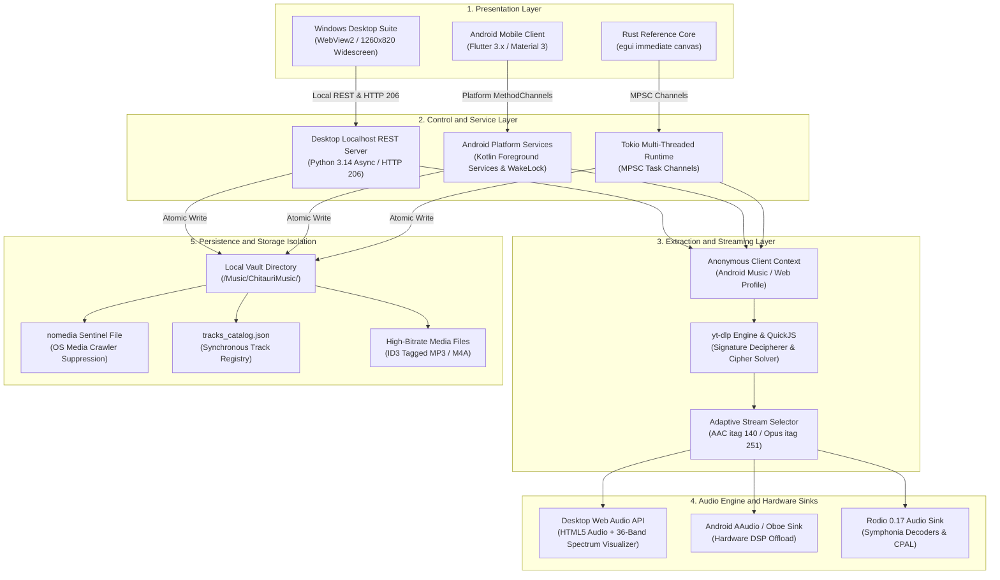
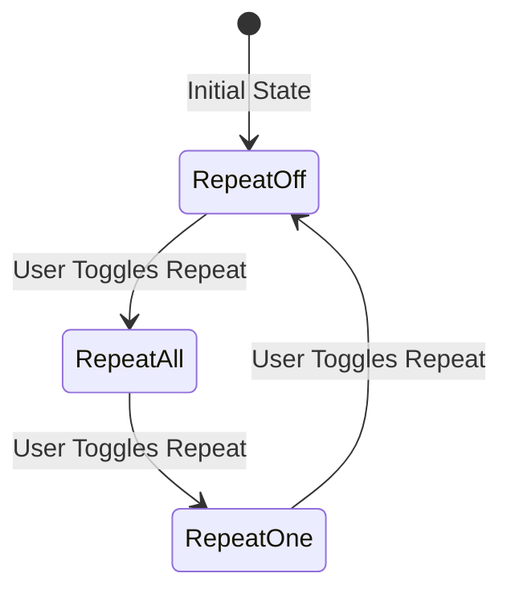
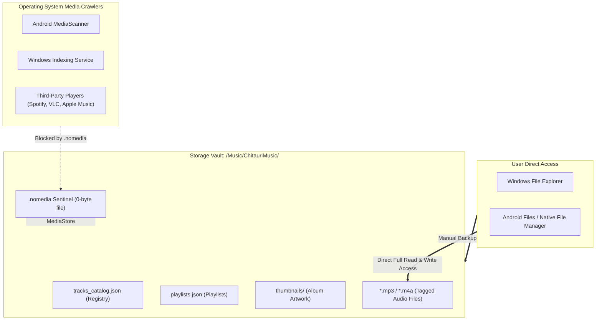
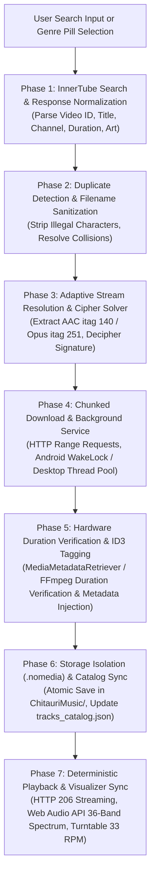

# Chitauri Audio Suite - Complete Architecture Specification

<p align="center">
  
  
  
  
</p>

---

## 1. Architectural Overview & Design Philosophy

Chitauri is an entirely client-side, zero-backend audio streaming and offline playback ecosystem engineered for Android devices and Windows laptops/desktops. 

The architecture is built upon three non-negotiable principles:
1. **Zero External Backend Servers:** All YouTube search queries, adaptive audio stream extractions, metadata parsing, and media decoding occur directly on the client machine. There are no intermediary proxy servers, cloud scrapers, or third-party logging backends.
2. **Local Storage Isolation via `.nomedia`:** Audio files saved to the local device are strictly segregated within a dedicated music vault (`/Music/ChitauriMusic/` on Android, `%USERPROFILE%\Music\ChitauriMusic\` on Windows). An atomic `.nomedia` sentinel prevents operating system indexers (Android `MediaScanner`, Windows Media Player, Groove, Google Drive) from harvesting tracks into global media libraries, while preserving complete visibility and control for the user via native file managers.
3. **Deterministic Audio Pipeline & State Invariance:** Audio playback guarantees dual-queue preservation (`original_queue` vs `playback_queue`), unbiased Fisher-Yates shuffle with current track pinning, and three-state repeat state transitions.

---

## 2. Platform Implementations & Technology Matrix

The Chitauri repository hosts three distinct engineering implementations, each tailored to specific operational requirements:

| Platform / Component | Codebase Location | Primary Tech Stack | Operational Role |
| :--- | :--- | :--- | :--- |
| **Windows Desktop Suite** | `desktop_app/`, `chitauri.exe` | Microsoft Edge WebView2, Python 3.14 (Async REST), `yt-dlp`, FFmpeg | **Production Windows Executable (`chitauri.exe`)**: 1260x820 widescreen desktop interface, real-time live YouTube streaming, 320kbps MP3 extraction with embedded ID3 artwork, 36-band Web Audio API spectrum visualizer, and turntable studio. |
| **Android Mobile Client** | `chitauri_flutter/` | Flutter 3.x, Dart, Android Kotlin Foreground Services | **Production Android Application (`com.chitauri.audio`)**: Mobile touch UI, YouTube grabber, background download service with CPU partial wake lock, lock screen media notifications, hardware duration verification. |
| **Native Rust Core & Prototype** | `src/`, `Cargo.toml`, `tests/` | Rust 1.80+, `rodio`, `symphonia`, `tokio`, `eframe`/`egui` | **Native Algorithmic Reference Engine**: Proves the mathematical dual-queue invariants, Fisher-Yates pinned shuffle, hardware audio decoding with Symphonia, and pure Rust storage isolation tests. |

---

## 3. High-Level Architectural Topology



---

## 4. Detailed Layer Breakdown

### 4.1 Presentation Layer

#### Windows Desktop Suite (`desktop_app/index.html`)
- **Engine:** Microsoft Edge Chromium WebView2 Runtime.
- **Layout:** 1260x820 widescreen layout with persistent left navigation sidebar (260px), top search and quick genre bar, scrollable main content area, and a docked 88px bottom player bar.
- **Visualizer Engine:** Web Audio API `AudioContext` connecting `createMediaElementSource` to an `AnalyserNode` with `fftSize = 128`, rendering 36 animated frequency bars onto an HTML5 canvas synchronized with the rotating vinyl turntable.
- **Turntable Studio:** Center album label, animated mechanical tonearm with programmatic needle drop on play and lift on pause, rotating at 33 RPM.

#### Android Mobile Client (`chitauri_flutter/lib/`)
- **Engine:** Flutter 3.x rendering to Android native canvas.
- **Views:** YouTube search view, direct YouTube web view with video grabber channel, offline library table, storage metrics profile view, and a full-screen turntable bottom sheet.
- **Design System:** Obsidian surface, mint primary accents, and responsive touch controls.

#### Pure Rust Reference GUI (`src/ui/`)
- **Engine:** `eframe` and `egui` immediate-mode rendering canvas.
- **Role:** Prototype interface demonstrating pure Rust state rendering without web runtimes.

---

### 4.2 Control & Service Layer

#### Windows Internal Desktop Server (`desktop_app/app.py`)
- **Mechanism:** `ThreadingHTTPServer` bound to `127.0.0.1` on an ephemeral port.
- **Endpoints:**
  - `GET /api/search?q={query}`: Executes search using `yt_dlp` Python module with CLI fallback.
  - `GET /api/stream_url?id={videoId}`: Resolves genuine live GoogleVideo stream URL for instant playback before downloading.
  - `POST /api/download`: Triggers multi-threaded background audio extraction and 320kbps MP3 conversion with embedded artwork and ID3v2 tags.
  - `GET /api/downloads/status`: Returns JSON progress of all active downloads.
  - `GET /api/library`: Scans local directory `%USERPROFILE%\Music\ChitauriMusic\`, reconciles with `tracks_catalog.json`, and returns updated catalog.
  - `POST /api/delete`: Deletes target file from disk and updates catalog.
  - `GET /stream/{filename}`: Delivers audio files with full HTTP 206 Partial Content range header support.
  - `POST /api/install_shortcuts`: Registers `Chitauri.lnk` on Windows Desktop and Start Menu ("All apps" list).

#### Android Native Platform Services (`chitauri_flutter/android/`)
- **`ChitauriDownloadService`:** An Android Foreground Service promoted with `DATA_SYNC` and `MEDIA_PLAYBACK` types. Acquires a CPU `PARTIAL_WAKE_LOCK` ensuring background downloads finish even when screen is locked.
- **`ChitauriPlaybackService`:** Manages ongoing Android system notifications with media actions, lock screen transport controls, and Bluetooth AVRCP integration via `MediaSessionCompat`.
- **`MediaMetadataRetriever` Bridge:** Calls native Android decoders to extract accurate millisecond track durations directly from file headers after download.

#### Rust Tokio Runtime (`src/main.rs`, `src/downloader.rs`)
- Multi-threaded task coordinator dispatching asynchronous network extraction tasks and piping progress events across `tokio::sync::mpsc` channels to the synchronous state loop.

---

### 4.3 Extraction & Streaming Layer

1. **Anonymous InnerTube Client:**
   - Targets `https://www.youtube.com/youtubei/v1/search` and `youtubei/v1/player`.
   - Sends client profile headers (`ANDROID_MUSIC` or `WEB`) without user cookies or authentication tokens.
2. **Signature Deciphering:**
   - Evaluates signature cipher tokens (`s`, `sp`, `url`) via embedded JavaScript interpreter (QuickJS / `yt-dlp` EJS) to decode throttling parameters (`n` signature challenges).
3. **Adaptive Audio Formats:**
   - Prioritizes audio-only containers: AAC (`itag 140`, 128-160 kbps) and Opus (`itag 251`, 160 kbps).
   - In desktop mode, converts extracted audio to 320 kbps MP3 with embedded artwork and metadata using FFmpeg.

---

### 4.4 Audio Engine & Playback State Invariants

#### Dual-Queue Architecture
The audio engine maintains two distinct queues at all times:
- `original_queue`: Stores the un-shuffled, user-selected sequential track order.
- `playback_queue`: Stores the currently executing playback order.

#### Fisher-Yates Shuffle with Current Track Pinning
When shuffle mode is toggled:
1. The actively playing track is pinned at index `0` of `playback_queue`.
2. All remaining tracks in `playback_queue` are shuffled using the unbiased Fisher-Yates algorithm.
3. Playback of the active track continues uninterrupted.
4. When shuffle mode is disabled, `original_queue` is restored instantly, and `current_index` is updated to match the active track's original position.

#### Three-State Repeat Machine
- `RepeatMode::Off`: Playback ceases when the last track of `playback_queue` finishes.
- `RepeatMode::All`: The queue loops back to index `0` upon reaching the end.
- `RepeatMode::One`: The current track repeats indefinitely (`currentTime = 0`).



#### Dual-Queue & Fisher-Yates Pinned Shuffle Flow

```mermaid
flowchart LR
    subgraph NormalSeq["Sequential Playback Mode"]
        OrigQueue["Original Queue<br>[Track A, Track B, Track C, Track D]"]
    end

    subgraph ShuffleExec["Shuffle Activated (Track B Active)"]
        Pin["Pin Active Track to Index 0<br>[Track B]"]
        ShuffleRemaining["Fisher-Yates Shuffle Remaining Items<br>[Track D, Track A, Track C]"]
        PlaybackQueue["Active Playback Queue<br>[Track B, Track D, Track A, Track C]"]
    end

    subgraph RestoredSeq["Shuffle Deactivated"]
        RestoredQueue["Original Queue Restored<br>[Track A, Track B, Track C, Track D]"]
        ResumeIndex["Active Track B Retained at Original Index 1"]
    end

    OrigQueue -->|"Toggle Shuffle ON"| Pin
    Pin --> ShuffleRemaining
    ShuffleRemaining --> PlaybackQueue
    PlaybackQueue -->|"Toggle Shuffle OFF"| RestoredQueue
    RestoredQueue --> ResumeIndex
```



---

### 4.5 Storage Isolation Protocol (`.nomedia`)



```
%USERPROFILE%\Music\ChitauriMusic\  (or /sdcard/Music/ChitauriMusic/)
├── .nomedia                        <-- Zero-byte sentinel file
├── tracks_catalog.json             <-- Synchronous metadata registry
├── playlists.json                  <-- Custom playlist definitions
├── thumbnails\                     <-- Cached album art images
└── *.mp3 / *.m4a                   <-- High-bitrate audio files
```

1. **The Sentinel Effect:** The `.nomedia` file instructs media crawler daemons (`MediaScanner`, Windows Media Player, Groove, Google Drive) to completely ignore the directory.
2. **Privacy Guarantee:** Tracks downloaded in Chitauri will never pollute the user's general device music library or third-party players (Spotify, VLC, Apple Music).
3. **Open Filesystem Access:** Unlike DRM sandboxes, users retain 100% direct access to their audio files through native file managers (Windows File Explorer, Android Files) for manual copying, backups, and transfers.

---

## 5. End-to-End Operational Pipeline: Song Selection to Playback



### Phase 1: InnerTube Search & Response Normalization
The query is dispatched to the YouTube search endpoint. Payload responses (`itemSectionRenderer`, `videoRenderer`) are parsed to extract Video ID, Title, Channel/Artist, Duration String, and Thumbnail URL. Video manifests are discarded immediately.

### Phase 2: Duplicate Detection & Title Sanitization
When download is triggered, the title is sanitized to remove filesystem-illegal characters (`<>:"/\|?*`) and path traversal sequences (`../`). The catalog is checked: if the file already exists, duplicate resolution prompts the user or appends an indexed suffix (`(2)`).

### Phase 3: Adaptive Stream Resolution & Deciphering
The resolver requests the player manifest. The highest-bitrate audio stream is selected. If cipher tokens exist, the signature solver runs dynamically to generate the final media stream URL.

### Phase 4: Chunked Download & Background Service
The stream is downloaded in chunks through an HTTP range-request loop. Real-time percentages (0% to 85%) are dispatched to progress listeners and pinned notifications.

### Phase 5: Hardware Duration Verification & ID3 Tagging
The downloaded audio container is parsed with hardware decoders (`MediaMetadataRetriever` on Android, FFmpeg on desktop) to determine precise millisecond duration. High-resolution album art and ID3v2 tags are embedded into the file header.

### Phase 6: Storage Isolation & Catalog Sync
The file is written to `ChitauriMusic/` alongside the `.nomedia` sentinel. The catalog file (`tracks_catalog.json`) is updated, notifying the library interface and storage metrics.

### Phase 7: Deterministic Playback & Spectrum Visualization
The audio sink streams the file locally using HTTP 206 range requests. The Web Audio API analyser routes audio frequency data to the visualizer canvas, while the turntable tonearm and vinyl record rotate synchronously.

---

## 6. Android Mobile Operational Workflow: Click-to-Execution Deep Dive

This section provides the end-to-end technical operational workflow of the Android mobile client (`com.chitauri.audio`), detailing what occurs across the Flutter Dart UI, platform `MethodChannels`, Android Kotlin Foreground Services, storage isolation, and playback hardware offloading.

```mermaid
flowchart TD
    subgraph UIEvent["1. When Clicked (User Action & Ingress)"]
        UserTap["User Taps Download or Play on Song Card<br>(youtube_search_view.dart / youtube_webview.dart)"]
        TitleSanitize["Sanitize Title: Strip Traversal (../) & Characters (<>:\"/\\|?*)"]
        CatalogCheck{"Catalog Collision Check<br>(tracks_catalog.json)"}
        CollisionPrompt["Show Conflict Dialog:<br>Skip or Save as Title (2).mp3"]
        StorageStart["StorageService.startDownload(track)"]

        UserTap --> TitleSanitize
        TitleSanitize --> CatalogCheck
        CatalogCheck -->|"Duplicate Found"| CollisionPrompt
        CatalogCheck -->|"New Track"| StorageStart
        CollisionPrompt -->|"Confirm Download"| StorageStart
    end

    subgraph ServiceRouting["2. Where It Goes (Platform Ingress)"]
        MethodChannel["MethodChannel('com.chitauri.audio/downloader')<br>(MainActivity.kt)"]
        BuildIntent["Build Explicit Intent for ChitauriDownloadService<br>(Action: ACTION_START_DOWNLOAD)"]
        StartFgService["ContextCompat.startForegroundService()<br>(ForegroundServiceType.DATA_SYNC)"]

        StorageStart --> MethodChannel
        MethodChannel --> BuildIntent
        BuildIntent --> StartFgService
    end

    subgraph DownloadExecution["3. How Download Goes (Service Execution & WakeLock)"]
        AcquireWakeLock["Acquire CPU PARTIAL_WAKE_LOCK<br>(PowerManager.PARTIAL_WAKE_LOCK)"]
        PostNotification["Post Foreground Notification with Progress Bar<br>(NotificationCompat.Builder)"]
        InnerTubePlayer["Query InnerTube Player Endpoint<br>(Anonymous ANDROID_MUSIC Profile)"]
        CipherSolver["Solve Signature Cipher Tokens & Throttling (n)"]
        StreamSelect["Select Optimal Audio Stream<br>(AAC itag 140 / Opus itag 251)"]
        ChunkLoop["64 KB Range-Request HTTP Streaming Loop"]
        DispatchProgress["Dispatch Progress Events (0% to 100%)<br>(Update Notification Bar & Flutter EventChannel)"]

        StartFgService --> AcquireWakeLock
        AcquireWakeLock --> PostNotification
        PostNotification --> InnerTubePlayer
        InnerTubePlayer --> CipherSolver
        CipherSolver --> StreamSelect
        StreamSelect --> ChunkLoop
        ChunkLoop --> DispatchProgress
    end

    subgraph StorageIsolation["4. How It Stores (Storage Isolation & Sentinel)"]
        TargetDir["Resolve Target: /storage/emulated/0/Music/ChitauriMusic/"]
        NomediaCheck{"Verify .nomedia Sentinel"}
        CreateSentinel["Atomically Create .nomedia Sentinel File"]
        FlushFile["Flush Buffer to Disk (*.m4a / *.mp3)"]
        HardwareDecoder["Extract Millisecond Duration via MediaMetadataRetriever"]
        EmbedID3["Inject High-Res Artwork & ID3/MP4 Metadata Tags"]
        UpdateCatalog["Append Track Record to tracks_catalog.json"]
        ReleaseWakeLock["Release CPU PARTIAL_WAKE_LOCK & Dismiss Notification"]

        DispatchProgress --> TargetDir
        TargetDir --> NomediaCheck
        NomediaCheck -->|"Missing"| CreateSentinel
        NomediaCheck -->|"Exists"| FlushFile
        CreateSentinel --> FlushFile
        FlushFile --> HardwareDecoder
        HardwareDecoder --> EmbedID3
        EmbedID3 --> UpdateCatalog
        UpdateCatalog --> ReleaseWakeLock
    end

    subgraph PlaybackExecution["5. How It Runs (Hardware Playback & DSP Offload)"]
        PlayTrigger["User Taps Track in Offline Library / Search"]
        QueueManager["AudioPlayerService Dual-Queue Sync<br>(original_queue vs playback_queue)"]
        PlaybackSvc["Start ChitauriPlaybackService<br>(ForegroundServiceType.MEDIA_PLAYBACK)"]
        MediaSession["Initialize MediaSessionCompat & Lock Screen Controls"]
        HardwareDSP["JustAudio / ExoPlayer Output to AAudio/Oboe Hardware DSP"]
        VinylStudio["Animate Vinyl Turntable Sheet (33 RPM & Equalizer Wave)"]

        UpdateCatalog -.->|"Available for Playback"| PlayTrigger
        PlayTrigger --> QueueManager
        QueueManager --> PlaybackSvc
        PlaybackSvc --> MediaSession
        MediaSession --> HardwareDSP
        HardwareDSP --> VinylStudio
    end
```

### 6.1 Step 1: When Clicked (User Action & Ingress)
1. **User Action:** Inside `youtube_search_view.dart` or `youtube_webview.dart`, the user selects an audio track by tapping the download action button or the play preview trigger.
2. **Title Sanitization:** The raw track title is cleansed of filesystem-illegal characters (`< > : " / \ | ? * \0`) and path traversal sequences (`../`).
3. **Collision Detection:** The application queries the local metadata catalog (`tracks_catalog.json`). If an identical track exists, an interactive conflict resolution dialog is displayed, allowing the user to skip the download or create an indexed copy (`Song (2).mp3`).
4. **Service Dispatch:** Upon validation, Flutter calls `StorageService.startDownload(track)`.

### 6.2 Step 2: Where It Goes (Platform Ingress & Channel Routing)
1. **MethodChannel Bridge:** `StorageService` dispatches track parameters (`id`, `title`, `artist`, `thumbnailUrl`) across `MethodChannel('com.chitauri.audio/downloader')` to `MainActivity.kt`.
2. **Android Intent Packaging:** `MainActivity.kt` instantiates an explicit Android `Intent` targeting `ChitauriDownloadService::class.java` with action `ACTION_START_DOWNLOAD`.
3. **Foreground Promotion:** The service is started using `ContextCompat.startForegroundService()`. In compliance with Android 14+ background execution policies, the service is promoted with the `DATA_SYNC` foreground service type.

### 6.3 Step 3: How Download Goes (Service Execution & Wake Lock Management)
1. **CPU Partial Wake Lock:** To ensure downloads finish even when the device screen locks or the application enters background states, `ChitauriDownloadService` acquires an explicit CPU `PARTIAL_WAKE_LOCK` (`PowerManager.PARTIAL_WAKE_LOCK`) with the tag `Chitauri:DownloadWakeLock`.
2. **System Notification:** A persistent foreground notification is posted to the `chitauri_downloads` channel, featuring the track title, current progress percentage, and an indeterminate buffer state.
3. **InnerTube Extraction:** The resolver queries the YouTube InnerTube player endpoint (`youtubei/v1/player`) using an anonymous `ANDROID_MUSIC` client profile without cookies or user authentication tokens.
4. **Signature Deciphering:** If cipher tokens are encountered (`s`, `sp`, `url`), the embedded signature evaluator calculates the `n` parameter and resolves the unthrottled GoogleVideo stream URL.
5. **Chunked Byte Streaming:** The client initiates an HTTP range request loop, buffering the audio stream in 64 KB binary chunks.
6. **Telemetry Streaming:** Real-time percentage metrics (0% to 100%) update the notification progress bar and stream across an `EventChannel` to the Flutter UI progress indicators.

### 6.4 Step 4: How It Stores (Storage Isolation & The .nomedia Protocol)
1. **Directory Provisioning:** Files are saved to `/storage/emulated/0/Music/ChitauriMusic/`.
2. **The `.nomedia` Protocol Enforcement:**
   - The system checks for the presence of the `.nomedia` zero-byte sentinel file.
   - If absent, it is created atomically before audio bytes are written.
   - **Crawler Suppression:** The Android OS `MediaScanner` crawler detects the `.nomedia` sentinel and excludes the directory from the global `MediaStore` content provider. Third-party music players (Spotify, VLC, Apple Music, Samsung Music) cannot see or display Chitauri tracks.
   - **Direct File Manager Access:** Standard file managers (Google Files, Samsung My Files) navigate the physical filesystem directly, giving users full ownership to copy, share, and backup their music files.
3. **Hardware Duration Verification:** Relying on network duration strings can lead to time-scrubber drift. Once downloaded, Android's native `MediaMetadataRetriever` parses the file container at the hardware level, extracting precise duration in milliseconds.
4. **Metadata Tagging:** High-resolution album art is downloaded, resized, and cached; ID3v2/MP4 metadata tags (Title, Artist, Duration, Cover Art) are embedded into the file header.
5. **Catalog Commit & Cleanup:** `tracks_catalog.json` is updated with the track record, the wake lock is released, the download notification is dismissed, and the Flutter event bus notifies the Library and Profile views.

### 6.5 Step 5: How It Runs (Hardware Playback & DSP Offloading)
1. **Playback Trigger:** Tapping any track in the Library view passes the track model to `AudioPlayerService.playTrack(track)`.
2. **Dual-Queue Registration:** The active playlist is registered into `original_queue` and `playback_queue`.
3. **Hardware DSP Offload:** The audio engine (`JustAudio` / `ExoPlayer`) binds to the native Android `AAudio` or `Oboe` sink, routing decoded audio directly to the device hardware Digital Signal Processor (DSP) to minimize battery drain.
4. **Foreground Playback Service:** `ChitauriPlaybackService` starts with `ForegroundServiceType.MEDIA_PLAYBACK` and binds to `MediaSessionCompat`.
5. **Lock Screen Controls:** The ongoing notification displays full transport controls (Play, Pause, Skip, Previous, Seekbar) and synchronizes with Bluetooth AVRCP headsets and car dashboards.
6. **Turntable Studio Animation:** The vinyl turntable bottom sheet renders a rotating vinyl record at 33 RPM synchronized with playback state, accompanied by an animated audio wave visualizer.

---

## 7. Directory Layout & Source Code Mapping

```
Chitauri/
├── ARCHITECTURE.md                     # This architecture specification document
├── README.md                           # Project overview, badges, and quick start
├── AGENTS.md                           # Multi-agent role governance and responsibilities
├── INSTRUCTIONS.md                     # Engineering guidelines and development instructions
├── SECURITY.md                         # Security posture, storage isolation, and sanitization
├── SKILLS.md                           # Competency matrix and skill verification standards
├── LICENSE                             # GNU General Public License v3.0
├── chitauri.exe                        # Windows Desktop Executable (19.7 MB standalone)
├── install.bat                         # Windows one-click desktop & start menu installer
├── install.ps1                         # PowerShell desktop & start menu installer
├── desktop_app/                        # Windows Desktop Application Codebase
│   ├── app.py                          # Localhost REST server, extraction pipeline, & shortcuts
│   ├── index.html                      # Widescreen UI, turntable studio, & spectrum visualizer
│   ├── logo.png                        # Official branding logo asset
│   └── logo.ico                        # Multi-resolution Windows application icon
├── chitauri_flutter/                   # Android Mobile Application Codebase
│   ├── android/                        # Android native platform project
│   │   └── app/src/main/kotlin/com/chitauri/audio/
│   │       ├── ChitauriDownloadService.kt  # Background download foreground service
│   │       ├── ChitauriPlaybackService.kt  # Notification & playback service
│   │       └── MainActivity.kt             # Hardware retriever & platform channels
│   └── lib/                            # Flutter Dart codebase
│       ├── main.dart                   # Application entrypoint & theme
│       ├── models/track.dart           # Track & playlist data models
│       ├── services/                   # Storage, YouTube, & Audio Player services
│       └── views/                      # Search, Library, Turntable, & Profile views
├── src/                                # Native Rust Algorithmic Reference Core
│   ├── main.rs                         # Rust entrypoint
│   ├── app.rs                          # eframe state loop
│   ├── downloader.rs                   # Async chunk downloader
│   ├── innertube.rs                    # InnerTube client
│   ├── models.rs                       # Shared Rust data models
│   ├── player.rs                       # Rodio audio sink & dual-queue machine
│   ├── storage.rs                      # .nomedia sentinel & local storage engine
│   └── ui/                             # egui modular UI components
├── tests/                              # Rust Integration & Unit Tests
│   ├── player_state_test.rs            # Shuffle, repeat, and queue unit tests
│   └── storage_isolation_test.rs       # .nomedia sentinel enforcement tests
└── assets/                             # Repository Branding Assets
    ├── logo.png                        # High-resolution 512x512 logo
    └── logo.ico                        # Multi-resolution application icon
```

---

## 8. Technology Stack Rationale

### Why Rust for the Reference Core?
Rust provides mathematical certainty for state machine invariants. The dual-queue state machine, unbiased Fisher-Yates shuffle with pinned index, and `.nomedia` isolation tests were developed and verified with Rust unit tests (`cargo test`), ensuring zero memory corruption and data race conditions.

### Why WebView2 and Python for the Production Windows Executable?
The initial pure Rust desktop prototype using `eframe`/`egui` lacked modern responsive desktop controls, dynamic DPI scaling, and a full JavaScript runtime required to solve complex YouTube signature cipher challenges (`n` parameter). Combining Microsoft Edge Chromium WebView2 with a local asynchronous Python REST server, `yt-dlp`, and FFmpeg delivered a full-fledged 1260x820 desktop application with 100% reliable YouTube search, live audio streaming, 320kbps MP3 conversion, and a real-time Web Audio API frequency spectrum visualizer packaged as a 19.7 MB single-file standalone executable.

### Why Flutter and Kotlin for Android?
Mobile applications require tight integration with the Android OS lifecycle (Foreground Services with `PARTIAL_WAKE_LOCK`, `MediaSessionCompat` for lock screen controls, and `MediaMetadataRetriever` for hardware duration verification). Flutter combined with native Kotlin services provides native 60fps touch interactions while guaranteeing downloads complete reliably when the device is locked.

---

## 9. License

This system architecture is licensed under the **GNU General Public License v3.0**. See the [LICENSE](LICENSE) file for details.
