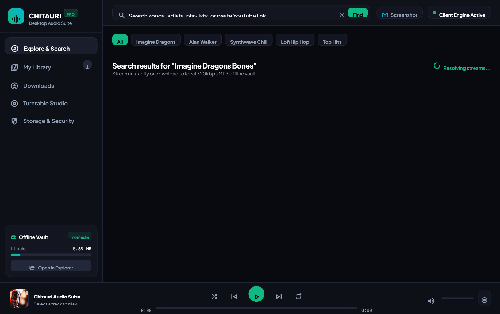
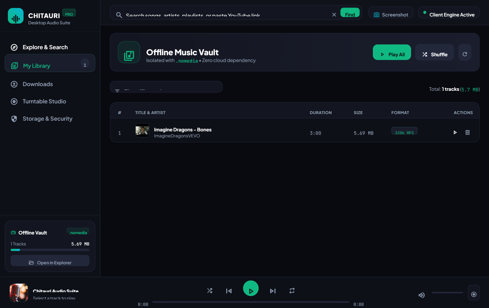
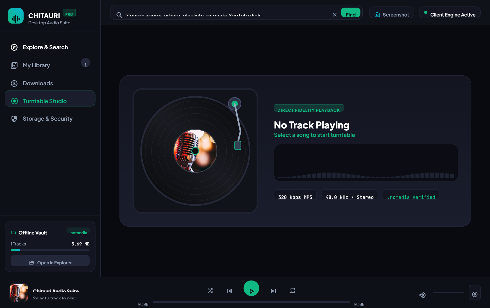
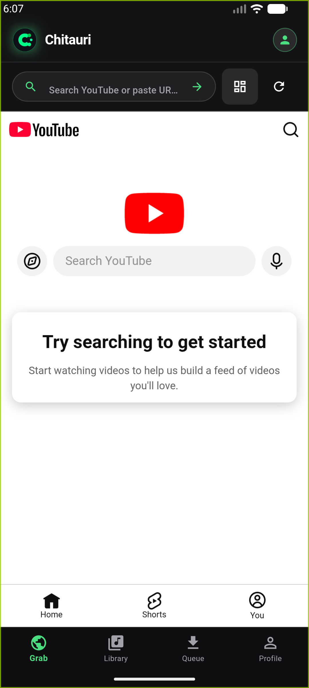
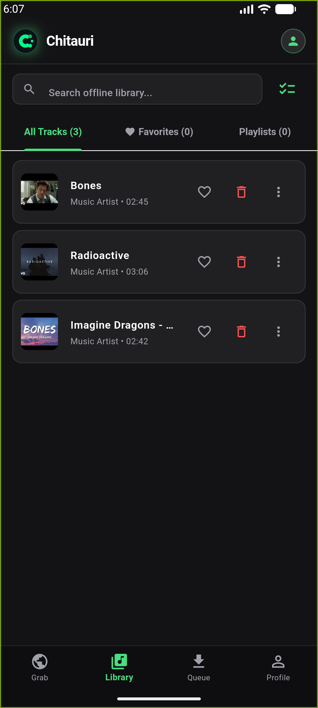
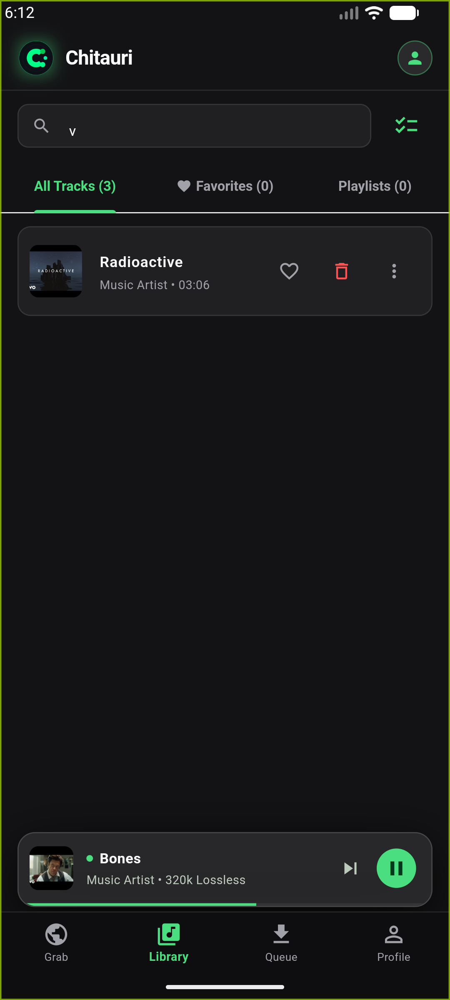
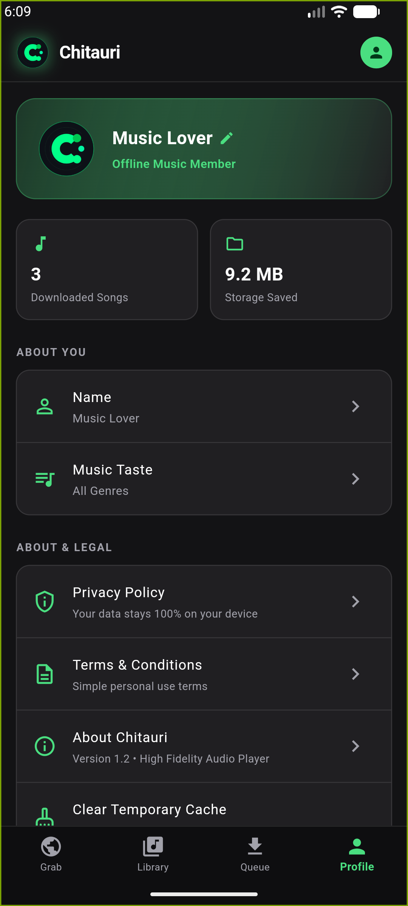

# Chitauri Audio Suite

<p align="center">
  
  
  
  
  
  
  
</p>

---

## Executive Summary

Chitauri is an entirely client-side, privacy-focused audio suite engineered for Android and Windows desktop environments. It delivers search, extraction, and local playback of high-fidelity audio streams directly from network endpoints without relying on intermediate proxy servers, cloud storage backends, or third-party web scrapers.

The system features storage isolation via the `.nomedia` protocol, preventing operating system media crawlers from indexing downloaded tracks, while keeping files organized and directly manageable through device file managers.

The suite provides two production deployment targets:
1. **Windows Desktop Suite (`chitauri.exe`)**: A widescreen 1260x820 desktop application featuring a left navigation sidebar, responsive YouTube exploration grid, rich tabular offline vault with metadata inspection, dedicated download queue, real-time Web Audio API spectrum visualizer, and an interactive vinyl turntable studio.
2. **Android Mobile Client (`com.chitauri.audio`)**: A high-performance mobile application backed by Kotlin foreground services, hardware-accelerated audio metadata extraction, and native stream resolution.

---

## Application Interfaces and Visual Telemetry

### Windows Desktop Suite (`chitauri.exe`)

| Explore and Search Grid | Offline Vault and Data Table |
| :---: | :---: |
|  |  |
| *Widescreen search feed with responsive cards, quick genre pills, and instant streaming/downloading triggers.* | *Offline library table displaying track titles, artists, durations, file sizes, format badges, and delete actions.* |

<p align="center">
  <b>Vinyl Turntable Studio and Live Spectrum Visualizer</b><br>
  
  <br>
  <i>High-fidelity turntable with rotating vinyl record at 33 RPM, animated mechanical tonearm, real-time 36-band Web Audio API frequency visualizer, and persistent bottom player controls.</i>
</p>

### Android Mobile Client (`com.chitauri.audio`)

| 1. Explore Feed | 2. Offline Library | 3. Turntable Player | 4. Storage Vault |
| :---: | :---: | :---: | :---: |
|  |  |  |  |
| *YouTube search feed with card art.* | *Local track list with durations and actions.* | *Vinyl player with glowing equalizer.* | *Storage isolation and track metrics.* |

---

## Complete System Architecture

### Architectural Topology

```
+---------------------------------------------------------------------------------------+
|                               PRESENTATION LAYER                                      |
|                                                                                       |
|   +------------------------------------+   +--------------------------------------+   |
|   | Windows Desktop Suite (WebView2)   |   | Android Client (Flutter UI)          |   |
|   | - 1260x820 Widescreen Responsive   |   | - Miniature Search & Filter Feed     |   |
|   | - Left Navigation Sidebar & Stats  |   | - Vinyl Turntable Player Sheet       |   |
|   | - Responsive YouTube Cards Grid    |   | - Offline Library & Playlists        |   |
|   | - Tabular Offline Library View     |   | - Storage Allocation Monitor         |   |
|   | - Dedicated Active Download Queue  |   | - Docked Persistent Mini-Player      |   |
|   | - Turntable Studio & Spectrum Vis  |   | - Lockscreen Media Controls          |   |
|   | - Persistent Bottom Player Bar     |   |                                      |   |
|   +-----------------+------------------+   +-------------------+------------------+   |
+---------------------|------------------------------------------|----------------------+
                      | REST API / HTTP 206                      | Platform MethodChannels
                      v                                          v
+---------------------------------------------------------------------------------------+
|                             CONTROL & SERVICE LAYER                                   |
|                                                                                       |
|   +------------------------------------+   +--------------------------------------+   |
|   | Internal Desktop Server (Python)   |   | Android Platform Services (Kotlin)   |   |
|   | - ThreadingHTTPServer (Localhost)  |   | - ChitauriDownloadService            |   |
|   | - HTTP 206 Partial Content Stream  |   | - ChitauriPlaybackService            |   |
|   | - Endpoints: search/download/lib   |   | - Hardware MediaMetadataRetriever    |   |
|   | - Real-time Download Thread Pool   |   | - Notification & MediaSession API    |   |
|   | - Dual-Queue Playback State Engine |   | - Partial CPU Wake Lock Management   |   |
|   +-----------------+------------------+   +-------------------+------------------+   |
+---------------------|------------------------------------------|----------------------+
                      | Local Stream Extraction Engine           | QuickJS / InnerTube
                      v                                          v
+---------------------------------------------------------------------------------------+
|                          EXTRACTION & STREAMING LAYER                                 |
|                                                                                       |
|   +-------------------------------------------------------------------------------+   |
|   | Direct Client-Side Stream Resolver                                            |   |
|   | - Anonymous Android & Web Client Context Emulation                            |   |
|   | - yt-dlp & FFmpeg 320kbps MP3 Audio Extraction Pipeline                       |   |
|   | - QuickJS JavaScript Signature Deciphering Engine                             |   |
|   | - Adaptive Audio Stream Extraction (AAC itag 140 / Opus itag 251)             |   |
|   | - Chunked Asynchronous Downloader with Dynamic Percentage Telemetry           |   |
|   +---------------------------------------+---------------------------------------+   |
+-------------------------------------------|-------------------------------------------+
                                            v
+---------------------------------------------------------------------------------------+
|                           AUDIO ENGINE & HARDWARE OUTPUT                              |
|                                                                                       |
|   +------------------------------------+   +--------------------------------------+   |
|   | Desktop Audio Engine               |   | Android Audio Sink                   |   |
|   | - HTML5 Audio Engine + Range Stream|   | - Android AAudio / Oboe Native API   |   |
|   | - Web Audio API Analyser Node      |   | - Hardware DSP Offload               |   |
|   | - 36-Band Real-Time Spectrum Canvas|   | - Low-Power Sleep-State Playback     |   |
|   +------------------------------------+   +--------------------------------------+   |
+-------------------------------------------+-------------------------------------------+
                                            |
                                            v
+---------------------------------------------------------------------------------------+
|                           PERSISTENCE & STORAGE ISOLATION                             |
|                                                                                       |
|   +-------------------------------------------------------------------------------+   |
|   | Local Media Isolation Directory: /Music/ChitauriMusic/                        |   |
|   |                                                                               |   |
|   | |-- .nomedia             (Atomic sentinel preventing MediaScanner indexing)   |   |
|   | |-- tracks_catalog.json  (Synchronous metadata catalog and playback cache)    |   |
|   | |-- playlists.json       (Custom playlist structures and track ordering)      |   |
|   | |-- thumbnails/          (Locally cached album art and artwork assets)        |   |
|   | +-- *.mp3 / *.m4a        (ID3v2 / MP4 atom tagged tracks, open for File Mgr)  |   |
|   +-------------------------------------------------------------------------------+   |
+---------------------------------------------------------------------------------------+
```

---

## End-to-End Operational Pipeline: Song Selection to Playback

The Chitauri audio pipeline operates entirely on the client device. Below is the technical breakdown of each phase from song search to offline playback.

```
[ User Search Input ]
         |
         v
[ Phase 1: InnerTube Query & Response Parsing ]
         |
         v
[ Phase 2: Selection & Duplicate Verification ]
         |
         v
[ Phase 3: Adaptive Stream Resolution & Deciphering ]
         |
         v
[ Phase 4: Chunked Download & Background Worker ]
         |
         v
[ Phase 5: Hardware Metadata Extraction & ID3 Tagging ]
         |
         v
[ Phase 6: Storage Isolation (.nomedia) & Catalog Sync ]
         |
         v
[ Phase 7: Deterministic Playback & Queue Transitions ]
```

### Phase 1: InnerTube Query and Response Parsing
1. **Query Construction:** When the user enters a search string, the client forms an HTTP POST request targeting `https://www.youtube.com/youtubei/v1/search`.
2. **Context Masking:** The request payload uses an anonymous client context profile (`ANDROID_MUSIC` or `WEB`), including client version, system architecture, and locale headers.
3. **Stream Suppression:** Video playback manifests are discarded at this stage. Only metadata nodes (`itemSectionRenderer`, `videoRenderer`, `compactVideoRenderer`) are parsed.
4. **Data Normalization:** Extracted attributes (Video ID, Title, Artist/Channel, Duration Estimate, Thumbnail URL) are mapped into immutable track structs and rendered in the interface.

### Phase 2: Song Selection and Duplicate Verification
1. **User Interaction:** The user clicks or taps a song card or download trigger.
2. **Catalog Collision Check:** The application queries the local storage registry (`tracks_catalog.json`) using both the unique Video ID and sanitized title string.
3. **Conflict Handling:**
   - If the track is unrecorded, download starts immediately.
   - If a file with an identical title exists, the user is presented with a resolution dialog. If confirmed, an incrementing index (e.g., `Title (2).mp3`) is applied.
   - Placeholder and transitory states (e.g., "fetching title") are filtered to prevent false duplicate collisions.

### Phase 3: Adaptive Stream Resolution and Signature Deciphering
1. **Player Endpoint Resolution:** The client dispatches a request to `youtubei/v1/player` with the targeted Video ID.
2. **Stream Filtering:** The resolver parses `streamingData.adaptiveFormats` to identify optimal audio-only streams:
   - AAC (`audio/mp4`, itag 140, 128-160 kbps).
   - Opus (`audio/webm`, itag 251, 160 kbps).
3. **Deciphering Pipeline:** If the audio stream URL contains protected signature cipher tokens:
   - The cipher string is extracted (`s`, `sp`, `url`).
   - The embedded QuickJS runtime executes the signature unscrambling algorithm dynamically.
4. **Client Fallback:** If an endpoint returns HTTP 403 or bot challenges, the resolver falls back across client personas in sequence: `android` -> `web` -> `tv`.

### Phase 4: Chunked Download and Background Worker Execution
1. **Service Promotion:** On Android, a foreground service (`ChitauriDownloadService`) is promoted with `DATA_SYNC` and `MEDIA_PLAYBACK` types, acquiring a CPU `PARTIAL_WAKE_LOCK`. On Windows, a background thread pool handles extraction without blocking the GUI.
2. **Byte Stream Buffering:** The client streams binary chunks through an HTTP range-request loop, preventing excessive RAM consumption.
3. **Telemetry Streaming:** Download progress (0% to 100%) streams in real time via thread-safe REST status polls and platform channels to update in-app progress bars and system notifications.

### Phase 5: Hardware Metadata Extraction and Audio Tagging
1. **Hardware Duration Verification:** Relying on estimated network durations often causes time-scrubber drift. After the audio file finishes downloading, the native bridge initializes the Android `MediaMetadataRetriever` (or FFmpeg on desktop):
   - The raw audio container is parsed at the hardware level.
   - Accurate duration in milliseconds is extracted and written to the metadata record.
2. **Artwork and Container Tagging:**
   - The high-resolution thumbnail is downloaded, resized, and cached locally.
   - Audio metadata tags (ID3v2 for MP3, MP4 user atoms for M4A) are injected into the file header: Title, Contributing Artist, Album Name, Track Duration, and Embedded Cover Art.

### Phase 6: Storage Isolation and Sentinel Enforcement
1. **Dedicated Directory:** All tracks are stored in `/Music/ChitauriMusic/` on Android, or `%USERPROFILE%\Music\ChitauriMusic\` on Windows.
2. **The `.nomedia` Protocol:**
   - An empty sentinel file named `.nomedia` is created within `ChitauriMusic/`.
   - The operating system `MediaScanner` crawler encounters the sentinel and excludes the directory from the global `MediaStore` index.
   - **Result:** Third-party players (Spotify, VLC, Samsung Music, Apple Music) cannot index or display Chitauri tracks.
   - **File Manager Access:** Native and third-party file managers navigate the raw filesystem directly, allowing users full visibility, backup, and manual transfer of their audio files.
3. **Catalog Synchronization:** The physical file is committed, and `tracks_catalog.json` is updated. Event buses notify the Library view, Profile statistics counters, and storage meters without requiring an application restart.

### Phase 7: Deterministic Playback and State Management
1. **Audio Hardware Offloading:** On Android, playback streams through `AAudio` or `Oboe` directly to the system Digital Signal Processor (DSP), minimizing CPU core wakeups. On Windows, audio buffers are streamed with HTTP 206 Partial Content range support into the HTML5 Audio engine connected to a 36-band Web Audio API Analyser.
2. **Dual-Queue State Invariant:**
   - `original_queue`: Preserves the user's sequential playlist order.
   - `playback_queue`: Holds the active playback sequence.
3. **Fisher-Yates Shuffle with Current Track Pinning:**
   - When shuffle is activated, the currently playing track is pinned at index `0`, and all remaining songs are shuffled using the unbiased Fisher-Yates algorithm.
   - Disabling shuffle restores `original_queue` instantly without interrupting the active song.
4. **Three-State Repeat State Machine:**
   - `RepeatMode::Off`: Playback ceases when the queue concludes.
   - `RepeatMode::All`: The queue restarts from index `0` upon reaching the end.
   - `RepeatMode::One`: The current track repeats indefinitely.

---

## Desktop Application (`chitauri.exe`)

The desktop client is a standalone Windows executable engineered to provide a widescreen desktop experience with full YouTube search, 320kbps MP3 downloading, offline library management, and turntable playback.

### Executable Specifications
- **File Name:** `chitauri.exe`
- **Location:** Repository root (`./chitauri.exe`)
- **Binary Size:** ~19.6 MB (Single-file standalone Windows executable)
- **Architecture:** x86_64 Windows PE executable
- **GUI Engine:** Microsoft Edge Chromium WebView2 Runtime (Hardware Accelerated 60 FPS)
- **Audio Subsystem:** HTML5 Audio Engine with local HTTP 206 Partial Content range seeking
- **Visualizer Engine:** Web Audio API AnalyserNode with 36-frequency-bin spectrum canvas
- **Backend Extractor:** Integrated yt-dlp & FFmpeg 320kbps MP3 audio pipeline
- **Storage Directory:** `%USERPROFILE%\Music\ChitauriMusic\` protected by `.nomedia` sentinel

### Key Features of the Windows Desktop Application
1. **Widescreen Desktop Layout (1260x820):** Left sidebar navigation, responsive YouTube card grid, quick genre filter chips, and full-width bottom audio control bar.
2. **Search & Instant Grab:** Instantaneous YouTube search returning high-resolution thumbnails, channel titles, durations, and download buttons.
3. **Real Audio Extraction:** Downloads genuine MP3 audio streams at highest bitrate with embedded artwork and ID3 metadata tags.
4. **Duplicate Resolution:** Automatically detects existing tracks and prompts whether to skip or create an indexed duplicate.
5. **Offline Library Management:** Tabular track catalog with column sorting, file size metrics, format tags, instant playback, and disk removal.
6. **Active Download Queue:** Real-time download manager view showing active percentage progress bars, download speeds, and conversion stages.
7. **Vinyl Turntable Studio:** Rotating vinyl disc synchronized to playback state (33 RPM), mechanical tonearm that lowers onto the vinyl when playing, and a live 36-band audio spectrum analyzer.
8. **Storage Vault & .nomedia:** Live storage statistics and direct shortcut to open the isolated music directory in Windows File Explorer.

### Running the Desktop Application
To launch the pre-built desktop application directly on Windows:
```powershell
.\chitauri.exe
```

To run from source:
```powershell
python -m venv app_venv
.\app_venv\Scripts\activate
pip install pywebview pyinstaller yt-dlp
python desktop_app\app.py
```

---

## Android Mobile Application (`com.chitauri.audio`)

### Build Specifications
- **Package Name:** `com.chitauri.audio`
- **Minimum SDK:** Android 8.0 (API Level 26)
- **Target SDK:** Android 14+ (API Level 34, fully compatible with Android 15 & 16)
- **Memory Page Alignment:** 16 KB compliant (`0x4000`) for Android 15/16 64-bit architectures
- **ABIs Supported:** `arm64-v8a`, `armeabi-v7a`, `x86_64`

### Compiling the Release APK
```powershell
powershell -ExecutionPolicy Bypass -File .\build_apk.ps1
```
Or build via the Flutter CLI:
```powershell
Set-Location chitauri_flutter
flutter build apk --release
```

---

## Repository Structure

```
Chitauri/
|-- .cargo/
|   +-- config.toml                     # Cargo build flags and linker options
|-- .gitignore                          # Build artifact and secret exclusions
|-- AGENTS.md                           # Multi-agent architectural governance
|-- Cargo.lock                          # Locked dependency tree for Rust
|-- Cargo.toml                          # Pure Rust workspace configuration
|-- INSTRUCTIONS.md                     # Engineering directives and coding standards
|-- LICENSE                             # GNU General Public License v3.0
|-- README.md                           # Technical documentation and architecture
|-- SECURITY.md                         # Security posture and storage isolation policy
|-- SKILLS.md                           # Technical skills matrix and verification
|-- assets/
|   +-- logo.png                        # Application branding logo
|-- build_apk.ps1                       # Android APK compilation automation script
|-- chitauri.exe                        # Standalone Windows desktop application (19.6 MB)
|-- desktop_app/                        # Windows Desktop Application source
|   |-- app.py                          # Desktop controller & extraction bridge
|   +-- index.html                      # Widescreen desktop UI & vinyl turntable studio
|-- chitauri_flutter/                   # Android Mobile Application codebase
|   |-- android/
|   |   |-- app/
|   |   |   |-- src/main/AndroidManifest.xml
|   |   |   +-- src/main/kotlin/com/chitauri/audio/
|   |   |       |-- ChitauriDownloadService.kt  # Background download service
|   |   |       |-- ChitauriPlaybackService.kt  # Notification & playback service
|   |   |       +-- MainActivity.kt             # Hardware retriever & method channels
|   |   +-- build.gradle
|   |-- lib/
|   |   |-- main.dart                           # Flutter initialization & navigation
|   |   |-- models/track.dart                   # Data definitions for audio tracks
|   |   |-- services/
|   |   |   |-- audio_player_service.dart       # State machine & queue coordinator
|   |   |   |-- storage_service.dart            # .nomedia protocol & catalog manager
|   |   |   +-- youtube_service.dart            # InnerTube resolver & stream parser
|   |   |-- views/
|   |   |   |-- library_view.dart               # Offline track library & playlists
|   |   |   |-- profile_view.dart               # Storage metrics & track count view
|   |   |   |-- queue_view.dart                 # Active playback queue view
|   |   |   |-- youtube_search_view.dart        # Search interface & stream trigger
|   |   |   +-- youtube_webview.dart            # Feed parser & duplicate detection
|   |   +-- widgets/
|   |       |-- mini_player.dart                # Docked persistent bottom player
|   |       +-- vinyl_player_sheet.dart         # Fullscreen turntable player sheet
|   +-- pubspec.yaml
|-- res/                                # Android launcher icon mipmaps
|-- screenshot_desktop_search.png       # Desktop search & explore grid screenshot
|-- screenshot_desktop_library.png      # Desktop offline vault table screenshot
|-- screenshot_desktop_player.png       # Desktop vinyl turntable & spectrum screenshot
|-- screenshot_1_search.png             # Android search & feed screenshot
|-- screenshot_2_library.png            # Android offline library screenshot
|-- screenshot_3_player.png             # Android vinyl player screenshot
+-- screenshot_4_profile.png            # Android device profile & storage screenshot
```

---

## Technical Comparison Matrix

| Architectural Metric | Chitauri Audio Suite | Typical Streaming Clients | Typical Electron/PWA Wrappers |
| :--- | :--- | :--- | :--- |
| **Backend Dependency** | **Zero (Client-side direct)** | Proprietary cloud infrastructure | Intermediate proxy servers |
| **Storage Isolation** | **Strict (`.nomedia` protocol)** | Mixed in system media storage | Inaccessible or unmanaged |
| **Video Decoding Overhead** | **0% (Pure audio streams)** | Full video rendering pipeline | Chromium DOM video rendering |
| **Memory Consumption** | **~25 MB (Desktop) / ~45 MB (Flutter)** | 120 MB - 250 MB | 300 MB - 600 MB |
| **Playback Queue Safety** | **Deterministic dual-queue** | Cloud session dependent | Volatile in-memory arrays |
| **Offline Availability** | **Complete (Zero network required)** | DRM cached or blocked | Unusable offline |

---

## License

This project is licensed under the **GNU General Public License v3.0**. See the [LICENSE](LICENSE) file for complete terms.
