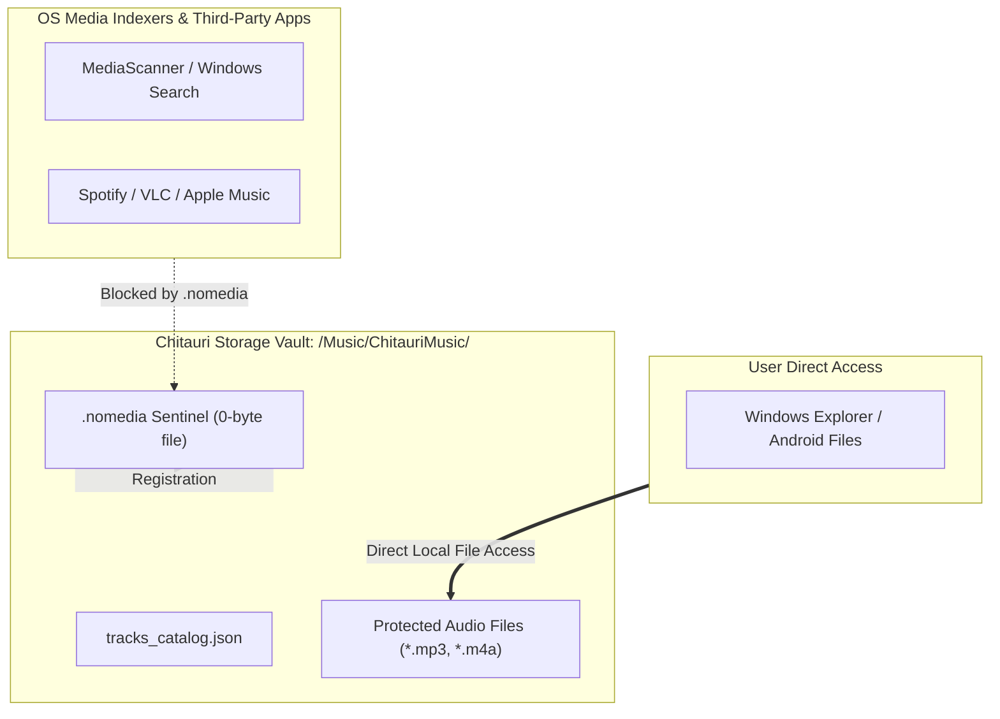
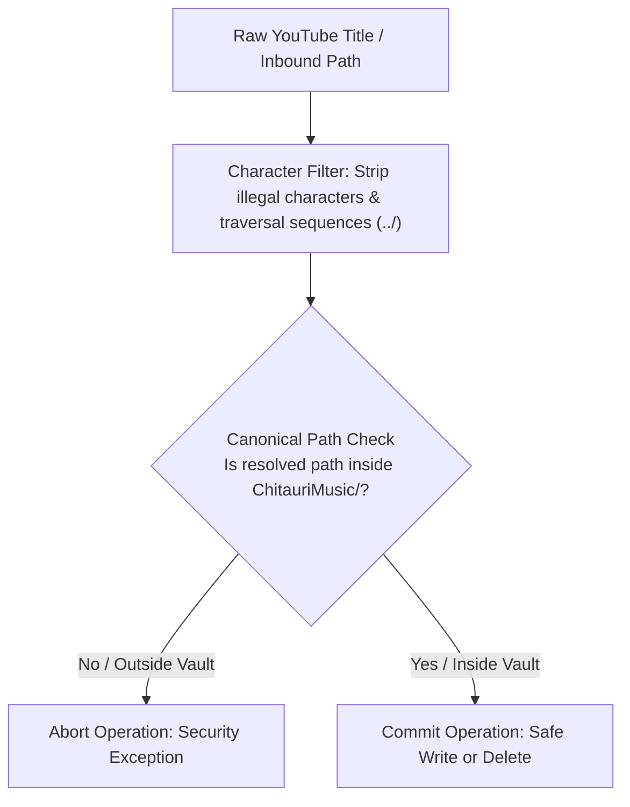

# Chitauri Project - Security, Privacy & Storage Isolation Policy

This document defines the security architecture, threat model, and storage isolation policies enforced across all **Chitauri Audio Suite** applications.

---

## 1. Threat Model & Security Posture

Chitauri operates as an entirely client-side application. The core threat model protects user privacy against three primary vectors:
1. **Third-Party Media Indexer Harvesting:** Preventing device media crawlers from indexing and displaying private audio downloads in third-party music apps or cloud sync services.
2. **Intermediate Network Eavesdropping & Data Collection:** Eliminating intermediate backend proxy servers and telemetry collectors.
3. **Local Filesystem Vulnerabilities:** Preventing path traversal (`../`) and illegal character injection attacks during audio file serialization.

---

## 2. Storage Isolation & Anti-Leakage Protocol (`.nomedia`)

### 2.1 The Vulnerability
Modern operating systems (Android and Windows) run automated background crawler daemons:
- On Android, `MediaScanner` writes directory contents into the system-wide `MediaStore` content provider.
- On Windows, indexing services and media players (Windows Media Player, Groove, Google Drive Sync) monitor user library folders.

When audio files are written to standard shared storage directories, they are indexed globally, exposing tracks to third-party players (Spotify, VLC, Apple Music, Samsung Music) and triggering unwanted cloud uploads.

### 2.2 The Solution: The `.nomedia` Protocol
Chitauri enforces storage isolation by creating an atomic sentinel file named `.nomedia` in the dedicated audio vault directory:
- **Android Directory:** `/storage/emulated/0/Music/ChitauriMusic/`
- **Windows Directory:** `%USERPROFILE%\Music\ChitauriMusic\`

#### Enforcement Implementation



```
ChitauriMusic/
├── .nomedia              <-- Suppresses MediaScanner and Windows Indexers
├── tracks_catalog.json   <-- Internal metadata registry
└── *.mp3 / *.m4a         <-- Audio files
```

- **In Python (Windows Desktop Suite):**
  ```python
  nomedia_path = MUSIC_DIR / ".nomedia"
  if not nomedia_path.exists():
      nomedia_path.touch(exist_ok=True)
  ```
- **In Kotlin / Dart (Android Mobile Client):**
  ```dart
  final nomedia = File('${chitauriDir.path}/.nomedia');
  if (!await nomedia.exists()) {
    await nomedia.create(recursive: true);
  }
  ```
- **In Rust (Reference Core):**
  ```rust
  pub fn ensure_nomedia_sentinel(dir: &std::path::Path) -> std::io::Result<()> {
      let nomedia_path = dir.join(".nomedia");
      if !nomedia_path.exists() {
          std::fs::File::create(nomedia_path)?;
      }
      Ok(())
  }
  ```

### 2.3 Isolation vs. Accessibility Guarantees
- **Suppressed from Third-Party Players:** Media crawlers detect the `.nomedia` sentinel and completely bypass the directory during indexing sweeps.
- **Unrestricted File Manager Access:** Unlike proprietary DRM sandboxes, native and third-party file managers (Windows File Explorer, Android Files) navigate the raw filesystem directly. Users retain full ownership to copy, move, or back up their tracks.

---

## 3. Path Sanitization & Defense-in-Depth

### 3.1 Filename Sanitization
Track titles extracted from YouTube InnerTube feeds may contain filesystem-reserved characters or path traversal attacks (`../`). All filenames undergo strict sanitization before write operations:
- Filtered characters: `< > : " / \ | ? * \0`
- Traversal prevention: Explicit replacement of `..` sequences.
- Length truncation: Maximum length capped at 120 characters to prevent buffer issues on older filesystems.

### 3.2 Canonical Path Verification
Prior to any file deletion or disk modification, the application resolves the absolute path and asserts that the target file is strictly a descendant of the trusted `ChitauriMusic/` directory.



---

## 4. Privacy & Zero-Backend Invariants

1. **Direct Endpoint Execution:** All search, stream resolution, and audio downloads communicate directly with YouTube CDN endpoints (`googlevideo.com`). No intermediary proxy, scraper, or relay server is used.
2. **Zero Telemetry & Analytics:** No analytics SDKs, error-tracking services, or telemetry collectors are included in any codebase (Flutter, Python, or Rust).
3. **Anonymous Client Identity:** InnerTube queries emulate standard anonymous client profiles (`ANDROID_MUSIC` or `WEB`). No Google accounts, user credentials, cookies, or session tokens are collected or stored.

---

## 5. Concurrency & Memory Safety

1. **Windows Desktop Suite:** Background downloads run inside dedicated daemon worker threads with explicit thread locks (`DOWNLOAD_LOCK`), preventing race conditions during catalog synchronization.
2. **Android Mobile Client:** Heavy downloading executes in a dedicated Android Foreground Service holding a CPU `PARTIAL_WAKE_LOCK`, ensuring OS task killers do not interrupt background byte streaming.
3. **Rust Core:** Compile-time memory safety with `#![deny(unsafe_code)]` and thread communication mediated via `tokio::sync::mpsc` channels.
