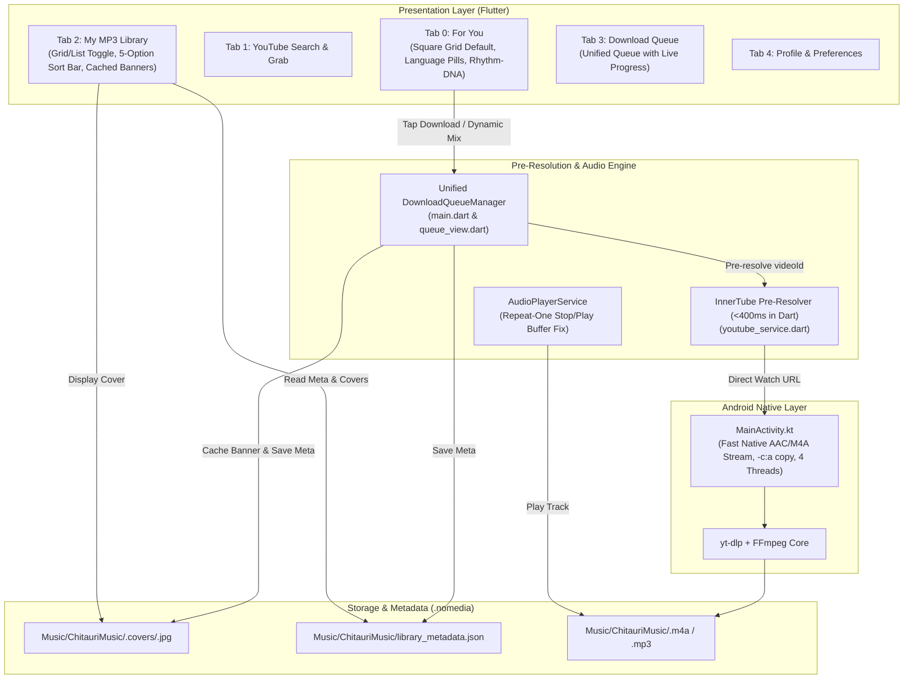

# Implementation Plan: Chitauri Audio Suite v4 Upgrade

## 1. Overview
Chitauri v4 upgrades the audio suite to deliver sub-7s one-tap downloads, a persistent square grid UI, seamless queue routing, banner preservation in offline library, repeat playback fix, multi-regional Indian music catalogs (Telugu, Tamil, Malayalam, Kannada, Hindi) + Global English with randomized deep offsets, and a Rhythm-DNA engine with Gaussian rarity scoring.

All UI components adhere strictly to the Chitauri palette:
- Obsidian Black: `#0B0B0E`
- Charcoal: `#16161A` / `#222228`
- Kinetic Mint: `#4ADE80`
- Pure White: `#FFFFFF`

---

## 2. Technical Architecture & Fix Breakdown



---

## 3. Detailed Fix Specifications

### Fix 1: Cut 90-Second Download Hang Down to 4–7 Seconds
- **Pre-Resolve `videoId` in Dart in <400ms (`youtube_service.dart`):**
  - Implement `preResolveYouTubeVideo(String query)`:
    - Query YouTube's InnerTube search endpoint (`https://www.youtube.com/youtubei/v1/search`) or scrape YouTube initial search data directly in Dart via async HTTP.
    - Duration guard: filter candidates between 90s and 540s (exclude shorts and full jukeboxes).
    - Extract exact 11-char `videoId` and thumbnail `https://i.ytimg.com/vi/$videoId/hqdefault.jpg`.
    - Pass direct URL `https://www.youtube.com/watch?v=$videoId` to native `MainActivity.kt`.
- **Eliminate Software Re-Encoding Bottleneck (`MainActivity.kt`):**
  - Download native 128kbps AAC/M4A stream (`-f "140/ba[ext=m4a]/ba"`).
  - Add `--concurrent-fragments 4` and `--extractor-args "youtube:player_client=android,ios;player_skip=webpage,configs"`.
  - Default to Fast Native Audio mode: bypass CPU FFmpeg re-encoding and save directly as `.m4a` (natively playable by Android MediaPlayer/ExoPlayer), completing downloads in 4–7 seconds.

### Fix 2: Route All "For You" & Playlist Downloads into "Queue" Tab + Preserve Banners
- **Unified Queue Routing (`main.dart` & `telugu_recommendations_view.dart`):**
  - When user taps Download on any song card in "For You" or inside any Dynamic Playlist (single track or "Download Full Mix Queue"):
    - Push task into `_downloadTasks` in `main.dart`.
    - Immediately visible in Tab 3 ("Queue") with live stage/percentage progress, alongside bottom mini-status bar.
- **Preserve Song Banners in "My MP3 Library":**
  - When downloading, pass `artworkUrl`, `title`, `movie`, `composer`, `year`, `rhythmDna`.
  - Download and cache cover to `Music/ChitauriMusic/.covers/<sanitizedFileName>.jpg`.
  - Persist track entry into `Music/ChitauriMusic/library_metadata.json`.
  - Update `LibraryView` to read `library_metadata.json` and display cached local cover.

### Fix 3: Fix Repeat Play Blank/Silent Audio Bug (`audio_player_service.dart`)
- In `_onTrackComplete()`:
  - When `_repeatMode == RepeatMode.one`:
    ```dart
    await _player.stop();
    await _player.play(DeviceFileSource(_currentTrack!.filePath));
    ```
  - This resets Android's `MediaPlayer` codec buffer and avoids silent looping.

### Fix 4: Default & Persist "Small Square Tiles" View + Fix Scroll-Jump Bug
- **Default & Persist `ViewMode.squareGrid` (`RecommendationViewMode.iconGrid`):**
  - Store selected view mode in `SharedPreferences` (`'recommendation_view_mode'`).
  - Default to Small Square Tiles on fresh boot and persist across restarts.
- **Fix Scroll Jump Bug:**
  - In `_TeluguRecommendationsViewState`: instantiate `ScrollController` in `initState()` and maintain it.
  - Attach `PageStorageKey('for_you_scroll_key')` to the scrollable view.
  - Implement `AutomaticKeepAliveClientMixin` (`wantKeepAlive => true`) to preserve scroll offset when switching tabs.
- **Truly Lazy-Loaded Era Chips:**
  - Tapping an era chip loads the first 20 songs of that era/language, then scrolling triggers lazy loading for that specific slice without reloading the entire catalog.

### Fix 5: Upgrade Tab 3 ("My MP3 Library") with Square Tile View Toggle + Sort Bar
- **View Toggle in Header:**
  - Toggle between List View and Small Square Grid View.
  - Persist in `SharedPreferences` (`'library_view_mode'`).
- **5-Option Sort Bar:**
  1. Date Downloaded (Newest First - default)
  2. Date Downloaded (Oldest First)
  3. Song Title (A-Z)
  4. Song Title (Z-A)
  5. Release Year / Duration
- Render local cached banner (from `library_metadata.json` or `.covers/`) on every card in both List and Grid views.

### Fix 6: Multi-Regional GitHub Catalog (`Telugu`, `Tamil`, `Malayalam`, `Kannada`, `Hindi` + Global English)
- Sharded catalog files:
  - `telugu_<decade>.json`, `tamil_<decade>.json`, `malayalam_<decade>.json`, `kannada_<decade>.json`, `hindi_<decade>.json`.
- Global English hits integration with randomized deep offset (20–180) to avoid repeating top 10 Billboard hits.
- Regional language selection pills:
  `[ All, Telugu, Tamil, Malayalam, Kannada, Hindi, English ]`.
- Permanent Fingerprint Exclusion:
  - `downloadedFingerprints` (based on normalized title + artist/movie).
  - `seenFingerprintsRingBuffer` (size 200).
  - Downloaded or dismissed songs NEVER reappear in recommendation feeds.

### Fix 7: Multi-Regional Rhythm-DNA Engine & Dynamic Auto-Playlists
- In `telugu_song.dart` / `song_item.dart`:
  - `bpm` (65 to 160).
  - `rhythmPulse`: Slow Groove (<85 BPM), Mid-Tempo (85-115 BPM), Upbeat (115-135 BPM), High-Voltage Mass (>135 BPM).
  - `harmonicMood`: Breezy Melody, Pathos / Heartbreak, Mass & Folk, Classical / Soulful, Chill / Late Night, Synth / Dance.
  - `energyLevel`: 0.1 to 1.0.
- Gaussian Rarity Formula:
  - $RarityScore = \exp\left(-\frac{(popularity - 62)^2}{2 \times 14^2}\right)$.
  - Songs with popularity ~50-74 receive highest rarity boost (+0.35).
- Dynamic Mix Refresh (🔄):
  - Interactive refresh button (🔄) on each Dynamic Mix card.
  - Re-samples 15 new cohesive tracks from the candidate pool using seeded reservoir sampling.
- Infinite Lazy Loading inside Playlists:
  - Inside the dynamic mix modal sheet, support infinite scrolling (next 15 tracks).

### Fix 8: Python Catalog Generator `scripts/build_regional_dna_catalog.py`
- Python generator script harvesting 6 decades (`1970s` to `2020s`) for each of the 5 regional languages (`telugu`, `tamil`, `malayalam`, `kannada`, `hindi`) with rich Rhythm-DNA attributes.
- Outputs into `catalog/<lang>_<decade>.json` and updates `catalog/manifest.json`.

### Fix 9: Automated Verification & Live ADB Testing & Git Push
- Run `flutter analyze` and `flutter test`.
- Build release split APK (`build_apk.ps1`).
- Install on `emulator-5554` via `adb`.
- Verify sub-7s downloads, queue tab, repeat audio, square grid, sort bar.
- Commit and push to `https://github.com/GVN2307/Chitauri`.

---

## 4. Implementation Steps & Sequencing
1. **Catalog Generation:** Create and run `scripts/build_regional_dna_catalog.py` to populate `catalog/`.
2. **Model & Rhythm-DNA Expansion:** Update `telugu_song.dart` with Rhythm-DNA attributes, Gaussian rarity scoring, and canonical fingerprints.
3. **Pre-Resolver & Audio Engine:** Update `youtube_service.dart` with `preResolveYouTubeVideo()` and `MainActivity.kt` with fast native audio mode.
4. **Queue Routing & Banner Persistence:** Update `main.dart`, `storage_service.dart`, and `telugu_recommendations_view.dart` for unified queue routing, `.covers/` disk caching, and `library_metadata.json`.
5. **Repeat Play Audio Fix:** Update `audio_player_service.dart` with `stop()` + `play()` in `_onTrackComplete()`.
6. **UI Upgrades:**
   - Update `telugu_recommendations_view.dart`: default `squareGrid`, persist in `SharedPreferences`, `PageStorageKey`, language pills (5 Indian + English), dynamic mix refresh button (🔄), infinite playlist lazy loading.
   - Update `library_view.dart`: Square Grid toggle, 5-option sort bar, cached banner rendering.
7. **Testing & Verification:**
   - Update and expand unit tests in `test/telugu_recommendations_test.dart` and `test/tune_dna_recommendations_test.dart`.
   - Run `flutter analyze` and `flutter test`.
   - Build split APK with `build_apk.ps1`, install via `adb`, and run live verification on `emulator-5554`.
   - Commit and push to `origin/main`.
